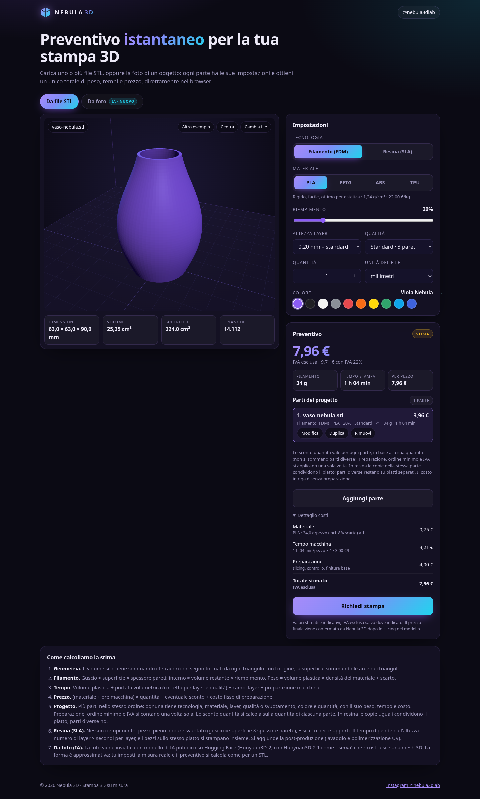
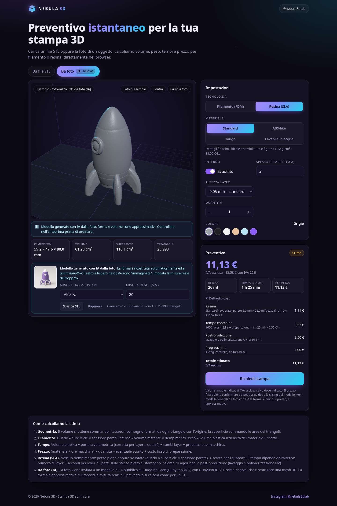
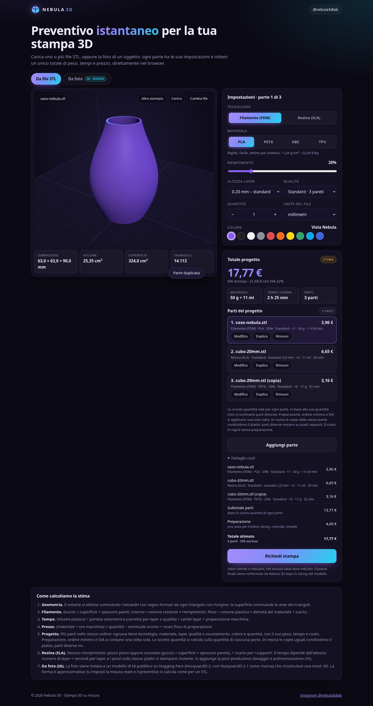

# Nebula 3D · Preventivo istantaneo per stampe 3D

Web app statica di [Nebula 3D](https://www.instagram.com/nebula3dlab/) (@nebula3dlab): carichi un file **STL** (oppure la **foto di un oggetto**, da cui l'IA ricostruisce un modello 3D) e ottieni subito, nel browser, anteprima 3D interattiva, dimensioni, volume, materiale, tempo di stampa e **prezzo stimato** con il dettaglio dei costi, per stampa a **filamento (FDM)** o a **resina (SLA/MSLA)**. Nessun backend: i file STL non lasciano mai il dispositivo dell'utente (solo in modalità "Da foto" la foto viene inviata a un servizio IA pubblico, vedi sotto).







## Funzionalità

- Trascina e rilascia (o scegli) uno o più file STL, **binari o ASCII**; pulsante **"Prova con un esempio"** con due modelli inclusi (vaso e cubo da 20 mm).
- **Progetto con più parti**: ogni STL (e, se vuoi, un modello da foto) è una parte con tecnologia, materiale, layer, qualità o svuotamento, colore e quantità propri. Il preventivo mostra il costo, il peso e il tempo di ogni parte e **un solo totale** per l'ordine.
- Anteprima 3D con rotazione, zoom e pan (three.js + OrbitControls, inclusi nel progetto: funziona offline).
- Calcolo di volume, superficie e ingombro in mm; avviso se il pezzo supera il volume di stampa (default 256 × 256 × 256 mm).
- **Due tecnologie**: interruttore *Filamento (FDM)* / *Resina (SLA)*, valido sia per gli STL sia per i modelli da foto.
- **Da foto (IA)**: carichi una foto (JPG, PNG, WEBP; HEIC solo dove il browser lo supporta, es. Safari) oppure premi **"Prova con una foto di esempio"**; il modello 3D viene generato in 10–30 secondi con stato della coda e tempo stimato, poi imposti la **misura reale** (altezza o lato più lungo, in mm), lo vedi in anteprima, lo scarichi con **"Scarica STL"** e ottieni il preventivo come per un STL.
- Impostazioni FDM: materiale (PLA, PETG, ABS, TPU), riempimento, altezza layer (0.12 / 0.20 / 0.28), qualità, quantità, unità del file (mm, cm, pollici) e colore (solo estetico).
- Impostazioni resina: Standard, ABS-like, Tough, Lavabile in acqua; pezzo pieno o **Svuotato** con spessore parete (default 2 mm); layer 0,025 / 0,05 / 0,1 mm; colore.
- Preventivo con dettaglio: materiale, tempo macchina, post-produzione (resina), sconto quantità, preparazione, ordine minimo, IVA.
- **"Richiedi stampa"**: apre un riepilogo pronto da copiare in un DM Instagram a @nebula3dlab o da inviare via email (link `mailto:` precompilato). Non viene inviato nulla in automatico.
- Interfaccia in italiano, tema scuro, responsive per smartphone.

## Come funziona la stima

Tutte le costanti stanno in **`js/config.js`**, commentate: prezzi al kg, densità, tariffa oraria, costo di preparazione, sconti, volume di stampa, contatti.

1. **Geometria** (`js/geometry.js`)
   - *Volume*: per ogni triangolo (a, b, c) si somma il volume con segno del tetraedro con l'origine, `a · (b × c) / 6`; il valore assoluto della somma è il volume del solido chiuso.
   - *Superficie*: somma di `|(b − a) × (c − a)| / 2`.
   - *Ingombro*: bounding box allineata agli assi.
2. **Filamento** (`js/estimate.js`)
   - Spessore guscio = numero di pareti (dipende dalla qualità) × larghezza linea (0,42 mm).
   - Volume guscio ≈ superficie × spessore guscio (al massimo il volume del pezzo).
   - Volume interno = volume − guscio; plastica = guscio + interno × riempimento %.
   - Peso = plastica (cm³) × densità del materiale, + scarto (8%).
3. **Tempo**: plastica ÷ portata volumetrica del materiale (mm³/s), corretta per altezza layer e qualità, + secondi per ogni cambio layer + minuti fissi di preparazione macchina per pezzo.
4. **Prezzo**: (costo materiale + ore × tariffa macchina) × quantità − sconto quantità + costo fisso di preparazione, con ordine minimo. IVA mostrata a parte.

### Resina (SLA/MSLA)

Costanti nel blocco `resin` di `js/config.js` (materiali con densità 1,10–1,18 g/cm³ e prezzo €/kg, layer e secondi per layer, scarto, tariffe, volume di stampa 218 × 123 × 235 mm modificabile). Calcolo in `estimateResin()` di `js/estimate.js`:

1. **Resina**: niente riempimento. Pezzo *pieno* = volume del modello; *svuotato* = guscio ≈ superficie × spessore parete (al massimo il volume). Si aggiunge il **12%** per supporti e scarto. Peso = ml × densità.
2. **Tempo**: dipende solo dall'**altezza** (si espone un layer intero alla volta): `layer = ⌈altezza / altezza layer⌉`, tempo = layer × secondi per layer (2,5–3 s, LCD mono) + 10 minuti di preparazione per stampa. Più pezzi uguali stanno insieme sul piatto (fino al 60% della sua area), quindi la quantità aumenta il tempo solo quando servono più stampe.
3. **Prezzo**: costo resina + ore × tariffa macchina resina (€/h separata) + **post-produzione** per pezzo (lavaggio e polimerizzazione UV), poi sconto quantità, preparazione, ordine minimo e IVA come per l'FDM.
4. Se il pezzo non entra nel volume della stampante a resina compare l'avviso, come per l'FDM.

### Progetto con più parti

Si possono mettere nello stesso ordine più parti, anche miste filamento e resina. Il modello è in `estimateProject()` (`js/estimate.js`); l'interfaccia tiene l'elenco nel pannello **Parti del progetto**.

- **Aggiungere.** Il primo file caricato è la parte 1. **«Aggiungi parte»** prepara una nuova riga (quantità 1, stesse impostazioni di partenza della parte corrente): poi si carica un STL, si sceglie un esempio, oppure si passa a **Da foto**. Si possono anche selezionare o trascinare **più STL insieme**: ognuno diventa una parte e non sostituisce quelle già presenti. **«Cambia file»** sostituisce solo la parte aperta.
- **Modificare, duplicare, togliere.** Si seleziona una parte (o **Modifica**) e il pannello Impostazioni vale solo per lei. **Duplica** ne fa una copia indipendente. **Rimuovi** la toglie dal totale. Con una sola parte il prezzo è **identico** al preventivo di prima.
- **Costo di riga.** Per ogni parte: materiale, tempo macchina, post-produzione (se resina) e lo **sconto quantità di quella parte**. Nel riepilogo questo importo è *senza* preparazione e *senza* ordine minimo.
- **Totale.** Si sommano i costi di riga, si aggiunge **una volta** il costo di preparazione (`setupFee`), si applica **una volta** l'ordine minimo (`minimumOrder`) e l'IVA (`vatRate`, mostrata a parte come oggi). Peso e tempo di stampa sono la somma delle parti.
- **Sconto quantità.** Si guarda la quantità **di quella parte**, non la somma delle quantità del progetto. Cinque copie di A e cinque di B prendono il 5% ciascuna, non il 10% che spetterebbe a dieci pezzi uguali. Sei parti diverse da un pezzo non scontano nulla.
- **Resina e piatti.** Le copie della **stessa** parte continuano a condividere il piatto (l'overhead di preparazione vasca si paga per ogni stampa, non per ogni pezzo). **Parti diverse non condividono il piatto**, anche se ci starebbero e usano la stessa resina: layer, materiale e colore possono differire, e il costo di una riga non deve cambiare quando se ne aggiunge un'altra. I tempi delle parti si sommano.
- **Filamento.** Le parti si stampano una dopo l'altra: i tempi si sommano, overhead per pezzo compreso.
- **«Richiedi stampa».** Con una parte il testo è quello di sempre. Con più parti elenca ogni parte (file o foto, misure, tecnologia, materiale, quantità, costo, peso, tempo) e il totale di progetto, preparazione inclusa una volta sola.

### Da foto: modello 3D generato con IA

> ⚠️ **Il modello generato è un'approssimazione.** L'IA "immagina" retro e parti nascoste, i dettagli fini possono mancare e la scala è sconosciuta (la imposta l'utente). Volume e prezzo sono quindi indicativi: l'interfaccia lo segnala e il preventivo viene confermato da Nebula 3D.

- Il sito è statico e **senza chiavi API**: dal browser dell'utente chiama, tramite [`@gradio/client`](https://www.gradio.app/guides/getting-started-with-the-js-client) (2.7.1, incluso in `vendor/gradio/`, licenza Apache-2.0), uno Space pubblico e gratuito di Hugging Face:
  - **primario** [`tencent/Hunyuan3D-2`](https://huggingface.co/spaces/tencent/Hunyuan3D-2) (endpoint `/shape_generation`, 30 passi, rimozione sfondo) — circa 10–15 s;
  - **riserva automatica** [`tencent/Hunyuan3D-2.1`](https://huggingface.co/spaces/tencent/Hunyuan3D-2.1) — circa 15–30 s; per questo Space lo sfondo uniforme della foto viene rimosso già nel browser.
- Logica in `js/photo3d.js`: ridimensionamento della foto (max 1024 px), coda con posizione e attesa stimata, timeout (240 s), annullamento, messaggi d'errore in italiano, poi il GLB viene letto con `GLTFLoader`, ripulito dai triangoli degeneri, ruotato in Z-up e scalato alla misura scelta; da lì in poi è lo stesso calcolo degli STL. `js/stl-export.js` crea l'STL binario scaricabile.
- **Limiti**: gli Space gratuiti usano *ZeroGPU*, con una **quota giornaliera per indirizzo IP** per gli utenti anonimi (pochi minuti di GPU al giorno: decine di generazioni, ma una rete condivisa può esaurirla prima). A quota esaurita il sito mostra fra quanto riprovare. Gli Space possono anche essere in pausa, cambiare API o venire rimossi da Tencent: Space e parametri si cambiano nel blocco `photoTo3D` di `js/config.js`. I modelli hanno ~250–300 mila triangoli (STL di 12–15 MB).
- Un'alternativa più affidabile richiede un piccolo backend (es. Cloudflare Worker) con un token Hugging Face o un'API a pagamento (Meshy, Tripo): non si può fare in un sito statico senza esporre la chiave.

È un'approssimazione: uno slicer considera supporti, sbalzi, ponti, accelerazioni e il percorso reale dell'ugello. I risultati sono indicati come **stime** nell'interfaccia.

## Avvio in locale

Serve un piccolo server web (i moduli JavaScript non si caricano da `file://`):

```bash
cd nebula-quote
python3 -m http.server 8000
# poi apri http://localhost:8000
```

In alternativa: `npx serve .`

## Pubblicazione su GitHub Pages

1. Crea un repository su GitHub (es. `nebula-quote`) e carica il contenuto di questa cartella:
   ```bash
   git remote add origin https://github.com/<tuo-utente>/nebula-quote.git
   git push -u origin main
   ```
2. Su GitHub: **Settings → Pages → Build and deployment → Source: Deploy from a branch**, branch `main`, cartella `/ (root)`.
3. Dopo un minuto il sito è online su `https://<tuo-utente>.github.io/nebula-quote/`.

Il file `.nojekyll` evita che GitHub Pages elabori il sito con Jekyll. Tutti i percorsi sono relativi, quindi funziona anche in una sottocartella.

## Personalizzazione

- **Prezzi e stampante**: modifica `js/config.js` (es. `machineRatePerHour`, `setupFee`, `materials.PLA.pricePerKg`, `buildVolume`).
- **Resina**: blocco `resin` (materiali, `layerHeights`, `supportWaste`, `machineRatePerHour`, `postProcessPerPart`, `buildVolume`, `defaultWallMm`).
- **Da foto**: blocco `photoTo3D` (Space primario e di riserva con i loro parametri, timeout, misura predefinita).
- **Email**: imposta `contact.email` in `js/config.js` per precompilare il destinatario del pulsante email.
- **Modelli di esempio**: `node tools/generate-samples.mjs` rigenera `samples/cubo-20mm.stl` (ASCII) e `samples/vaso-nebula.stl` (binario).

## Test

```bash
node tests/geometry.test.mjs       # volumi e aree di forme note (cubo 20 mm = 8 cm³, cilindro, vaso)
node tests/resin.test.mjs          # calcoli resina: pieno/svuotato, layer, piatti, prezzo, volume
node tests/project.test.mjs        # progetto: una parte = preventivo singolo; preparazione e minimo una volta; sconto per parte; piatti resina non condivisi fra parti diverse
npm i puppeteer-core               # solo per i test nel browser
python3 -m http.server 8765 & node tests/e2e.mjs   # end-to-end: STL, FDM↔resina, foto con IA simulata (?mock3d=1), riserva, annulla, Scarica STL, mobile
node tests/e2e-real.mjs            # UNA generazione reale da foto con tempi (consuma quota ZeroGPU)
```

Parametri URL utili per demo e test: `?mode=photo`, `?tech=resin`, `?sample=1`, `?photo=1` (genera dalla foto di esempio), `?mock3d=1` (generazione simulata con `tests/fixtures/razzo-generato.glb`, nessuna chiamata di rete).

## Struttura

```
index.html            pagina
css/style.css         stile
js/config.js          tutte le costanti di prezzo e stima
js/geometry.js        parsing STL, volume, superficie, ingombro
js/estimate.js        modello di stima FDM, resina e totale di progetto
js/photo3d.js         foto → modello 3D (Hugging Face Spaces, GLB → mesh)
js/stl-export.js      esportazione STL binario
js/app.js             interfaccia e anteprima 3D
vendor/three/         three.js r160 + GLTFLoader (licenza MIT)
vendor/gradio/        @gradio/client 2.7.1 (licenza Apache-2.0)
samples/              STL e foto di esempio
tools/                generatore degli esempi
tests/                test (fixtures/: GLB generato dal servizio per il mock)
```
